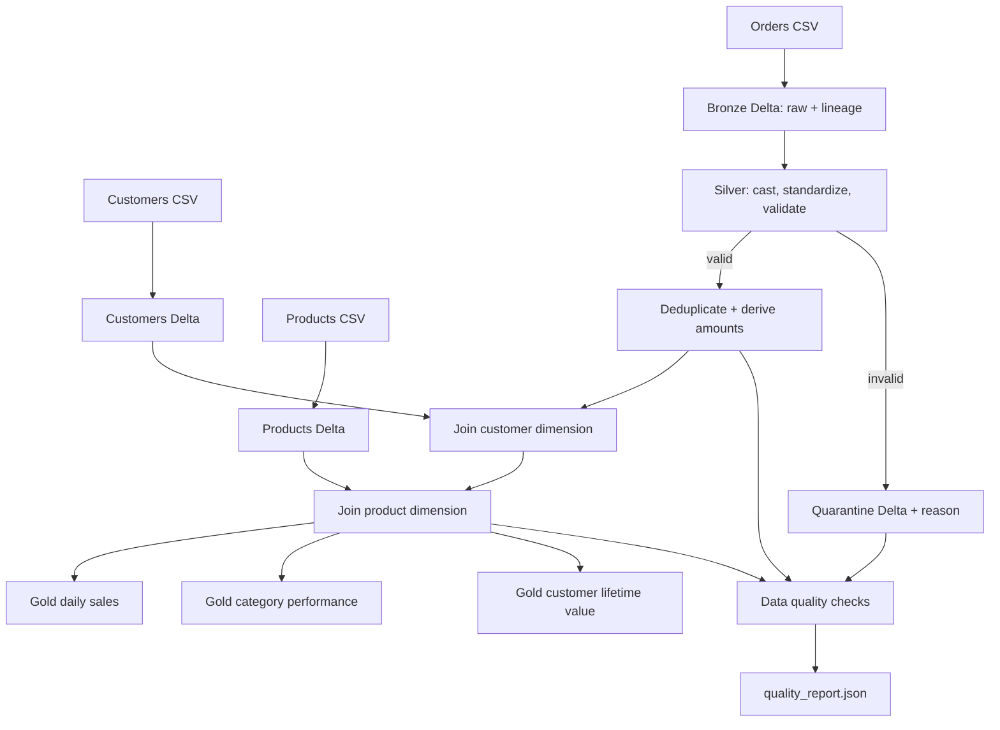

# Architecture and operational flow

## Layer contracts

| Layer | Contract | Consumers |
|---|---|---|
| Bronze | Source-aligned strings, immutable lineage fields | Replay/debugging |
| Silver | Typed, validated, deduplicated order facts | Gold transformations |
| Quarantine | Rejected source rows and reason codes | Data stewards / remediation |
| Gold | Business aggregates and dimensional context | BI / analytics |

## Production Azure mapping

- Landing: ADLS Gen2 raw container
- Ingestion/orchestration: Azure Data Factory
- Processing: Azure Databricks (PySpark + Delta Lake)
- Curated storage: ADLS Gen2 Delta tables
- Governance: Unity Catalog / managed identity / Key Vault
- Consumption: Synapse, Databricks SQL, or Power BI
